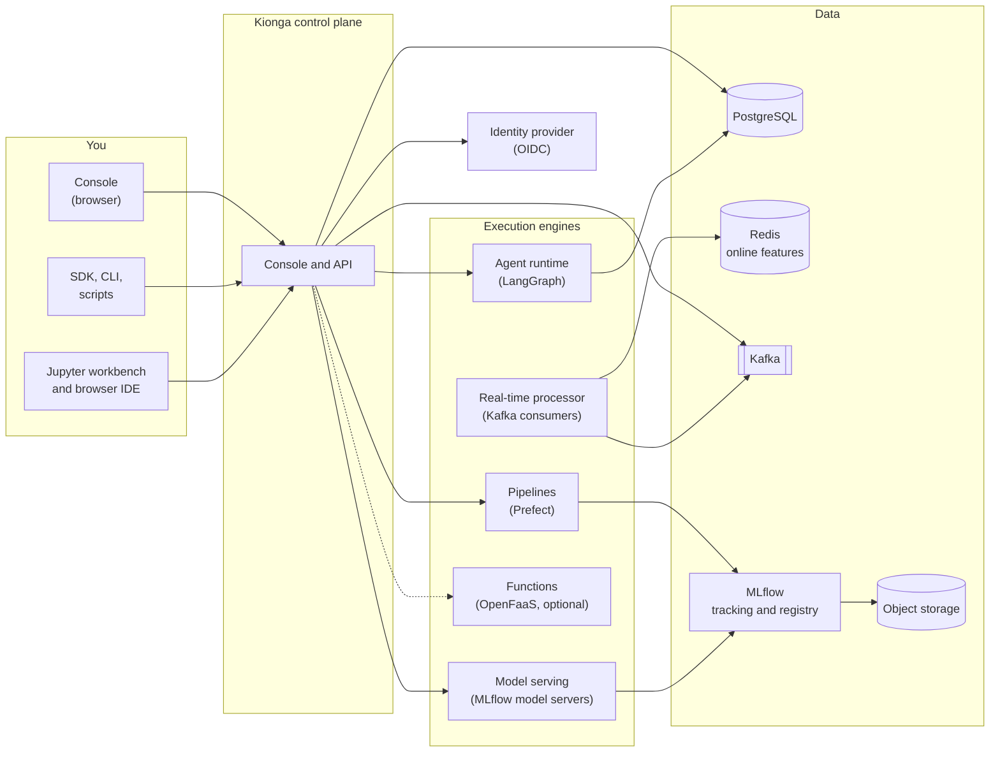

# How Kionga works

Kionga is a control plane: one API and console that you use to manage ML and AI
work, plus the engines and stores that do the work. You describe what you want
(a project, a pipeline run, a model deployment, an agent), and Kionga records it,
checks that you are allowed to do it, and drives the engine that carries it out.

This page explains the parts at the level you need to use and operate Kionga. For
the full design, see the
[architecture in the engineering handbook](https://kiongahq.github.io/docs/engineering/architecture/).

## The console and API

Everything in Kionga goes through one API under `/api/v1`. The web console is a
client of that same API, and so are the Python SDK, the `mlaiops` CLI, and your
own scripts. Anything you can do in the console you can automate. See the
[REST API reference](../reference/api.md).

For every request, the API:

1. Identifies the caller (see [Identity and access](#identity-and-access)).
2. Checks the caller's role, service grants, project scope and policies.
3. For a change, checks quotas and resource limits, records the change, and
   writes an audit event.
4. Calls the engine that does the work, such as the pipeline engine for a run or
   the serving manager for a model deployment.

If an engine rejects the work, Kionga records the failure (for example, the run
is marked `failed`) instead of reporting success. The console stays current
through a live event stream, so run graphs, sessions and dashboards update
without a page reload.

## Projects and workspaces

A **project** is the unit of ownership. Pipelines, models, agents, functions and
their history belong to a project, and access is granted per project. A project
is created from a versioned **project template** that records its framework,
accelerator and resource profile, and can be connected to a Git repository.

A **workspace** is where you write code: JupyterLab (the workbench) and a browser
IDE (code-server). You open both from the console with your console session. Inside a
workspace, the SDK and the `kionga` command already know how to reach Kionga, and
calls run as the workspace owner with that owner's current permissions, so you do
not need an API key. On the local stack, everyone shares one workspace owned by
the local `admin` account. On Kubernetes, each user
gets an isolated workspace sized by their resource profile.

See [Core concepts](core-concepts.md) for every resource.

## Execution engines

Kionga orchestrates proven open-source engines rather than replacing them.

| Work | Engine | What Kionga adds |
| --- | --- | --- |
| Pipelines | Prefect runs flows; container steps run as isolated containers | Versioned flow definitions, validated dependency graphs, schedules, run history, step logs, resource admission |
| Experiment tracking and registry | MLflow | Project ownership, quality gates, promotion stages, audit |
| Model serving | One MLflow model server per deployed model version | Deploy, test, roll back, and a live endpoint per model |
| Agents | The agent runtime runs LangGraph graphs over HTTP | Agent registry, sessions, turn and token accounting, traces, capacity checks |
| LLM calls | Your provider (OpenAI, Anthropic, or any OpenAI-compatible server) | A trace proxy that records OpenAI-protocol calls; a `mock` model that needs no provider key |
| Functions | OpenFaaS or faasd, which you provide | Function registry, quotas, triggers, invocation, use as pipeline steps |
| Real-time | Kafka consumers | Enrichment with online features and scoring with models or agents |

An engine that is not configured shows as **not configured** in the console. For
example, functions stay unavailable until an administrator sets `OPENFAAS_URL`.

## Where data lives

| Store | Holds |
| --- | --- |
| PostgreSQL | Kionga's own records (projects, runs, models, agents, users, policies, audit), MLflow and Langfuse metadata, agent conversation checkpoints, and agent long-term memory (pgvector) |
| Object storage (S3-compatible) | Model artifacts, pipeline artifacts and logs, offline feature snapshots, agent state, and traces |
| Redis | Online features for low-latency lookups |
| Kafka | Lifecycle events, LLM traces, and real-time streams |
| MLflow | Experiments, runs, metrics, and the model registry (stored in PostgreSQL and object storage) |

Kionga keeps credentials out of its records. Connections to infrastructure,
storage and feature stores store only a reference to an environment variable on
the server. LLM provider keys stay in the environment. Personal API keys are
stored as hashes, and a user's Hugging Face token is stored encrypted.

## Identity and access

People sign in to the console in one of two ways:

- **Single sign-on** through any OIDC provider. The local stack includes Dex,
  which connects to LDAP, SAML, GitHub, Google, Microsoft and other directories.
- **Local accounts**, for development or as break-glass access next to single
  sign-on.

Code authenticates with a **personal API key** (outside Kionga) or automatically
through the workspace identity (inside a workspace). Kionga's own services use an
internal service token that can only report status.

Access is deny by default and has three layers:

1. **Role**: `admin`, `operator`, `engineer`, `user`, or `viewer`.
2. **Access profile**: for a normal `user`, the services, projects, storage
   buckets and compute quotas an administrator grants.
3. **Policies**: optional allow and deny statements on specific actions and
   resources. An explicit deny always wins.

The console hides what you cannot use, but the API enforces every rule. See
[Permissions](../reference/rbac.md) and
[Users, roles and policies](../guides/access-control.md).

## Deployment options

The same Kionga runs in three shapes. They differ in who provides the engines and
stores, and in how isolated each user is.

| | Local | Single server | Kubernetes |
| --- | --- | --- | --- |
| For | Learning, development, demos | A small team pilot | Teams and production |
| What Kionga runs | Everything: the control plane, every engine and store, Dex, and the workbench | The control plane behind a TLS edge (Caddy) | The control plane, Kubernetes operator, feature and storage services, and trace proxy, with replicas and autoscaling |
| What you provide | Docker | An OIDC provider, PostgreSQL, and the ML services you connect | An OIDC provider, PostgreSQL, Kafka, MLflow, a pipeline engine, object storage, and an ingress |
| Workspaces | One shared workbench | Not included | One isolated workspace per user |
| Agents | One shared runtime | Not included | One runtime per agent, with optional autoscaling |
| Access from other machines | No, ports bind to `127.0.0.1` | HTTPS only, ports 80 and 443 | Through your ingress |
| Guide | [Run locally](../operations/local.md) | [Single server](../operations/public-vm.md) | [Deploy on Kubernetes](../operations/managed-kubernetes.md) |

Inside the local stack, services reach each other by service name (for example,
`http://mlflow:5000`), while you reach them on `localhost` ports. Connections you
register in the console are checked from inside the stack, so they use service
names. See [Service endpoints](../reference/service-endpoints.md).

## Related

- [What is Kionga](what-is-kionga.md)
- [Core concepts](core-concepts.md)
- [Services and ports](../reference/services.md)
