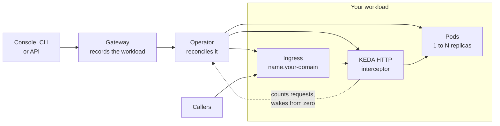

# Self-healing and autoscaling

On Kubernetes, every application, function and agent that Kionga runs is a pod
that Kionga keeps healthy and sizes for you. This page explains what happens
behind the scenes, so you can pick sensible settings and read what you see when
something goes wrong. It applies to [applications](../guides/applications.md), functions and
[agents](../guides/agents.md).

Compose and single-server installs do not run these controllers. There, a
container runtime restarts a container that exits, and nothing scales it.

## How it fits together

You describe a workload once. The gateway records it and creates a Kubernetes
resource. The Kionga operator turns that resource into the objects that run
it and reports status back, which is what the console and the CLI show.

## Self-healing

Self-healing is Kubernetes doing its job, with settings that Kionga picks for
you.

**Probes.** Every application and function pod has three health checks on the
[health path](../guides/applications.md#health-check) you set. With no path, the
check opens a connection to the port instead.

| Probe | When it runs | If it fails |
| --- | --- | --- |
| Startup | Every 2 seconds, for up to 2 minutes after the container starts | The container restarts. Readiness and liveness checks wait for startup to pass. |
| Readiness | Every 5 seconds | After 3 failures in a row, the pod stops receiving traffic. It receives traffic again when the check passes. |
| Liveness | Every 10 seconds | After 3 failures in a row, Kubernetes restarts the container. |

Each check times out after 2 seconds. A check passes on any HTTP status from 200
to 399.

**Restarts.** A container that crashes or fails its liveness check is restarted in
place. If a pod disappears, for example because its node failed, the Deployment
creates a replacement on another node.

**Rolling updates.** When you change an application or redeploy it, Kionga starts
one new pod first and removes an old pod only after the new one passes its
readiness check. It never removes a pod before its replacement is ready, so a
workload with at least two replicas keeps serving through an update. A workload
with one replica also keeps serving, because the old pod stays until the new one
is ready. If a rollout makes no progress for 10 minutes, the workload shows the
phase `Failed` with the reason `ProgressDeadlineExceeded`, and the old pods keep
running.

**Disruption budget.** When a workload's minimum is two replicas or more, Kionga
adds a PodDisruptionBudget that allows at most one pod to be unavailable during
voluntary disruptions, such as a node drain for an upgrade. A workload that can
scale to zero or runs a single replica has no budget, because a budget on one pod
would block node drains.

**Locked-down pods.** Application and function pods run as a non-root user with
all Linux capabilities dropped, privilege escalation off, the container
runtime's default seccomp profile, and no Kubernetes API token. Your image must
set a numeric non-root user (`USER 10001` in a Dockerfile), or Kubernetes
refuses to start it.

**What you see.** The workload's status reports one phase:

| Phase | Meaning |
| --- | --- |
| `Building` | A Git source is building for the first time. Nothing runs yet. |
| `Progressing` | A rollout is underway, or the first pods are starting. |
| `Ready` | The current version has the replicas it needs, or it is scaled to zero on purpose. |
| `Degraded` | No rollout is underway, but fewer replicas are available than the minimum. For example, a pod crashed and is restarting. |
| `Failed` | The spec is invalid, a referenced Secret is missing, the build or rollout failed, or the rollout exceeded its deadline. The status message gives the reason. |

## Autoscaling

A workload has a replica range, `min` to `max`, and a trigger that decides where
inside that range it sits. Kionga supports two triggers.

### Scale on requests

The default when the KEDA HTTP add-on is installed. Kionga routes traffic
through the add-on's interceptor, which counts the requests in flight. The target
is the number of concurrent requests each replica should handle. Add replicas when
the average goes above the target, and remove them when it falls.

- The default target is 100 concurrent requests per replica. It can be any whole
  number from 1 to 10000.
- A workload scaled on requests can scale to zero (set the minimum to 0). After
  5 minutes without requests, the last replica is removed.
- The next request wakes the workload. The interceptor holds the request while a
  replica starts and forwards it when the pod is ready. It holds requests for the
  add-on's wait limit, which is 20 seconds by default, so a slow-starting image
  makes the first request after idle slow or fail.
- A new workload starts with one replica even when the minimum is 0, so the first
  rollout proves that the image runs. It scales to zero after the idle period.

Requests scaling suits workloads that wait on other systems, such as model
calls or databases, because they can be slow without using much CPU.

### Scale on CPU

Kionga adds a Kubernetes HorizontalPodAutoscaler. The target is average CPU
utilization as a percentage of the replica's CPU request (the default is 80). It
needs the Kubernetes metrics API, so metrics-server must run in the cluster.

- A CPU-scaled workload always keeps at least one replica. A minimum of 0 is
  refused.
- If the minimum equals the maximum, there is nothing to scale, and Kionga runs a
  fixed number of replicas with no autoscaler.

CPU scaling suits workloads that do their work in the process, such as image
processing, and installs without KEDA.

### Without the KEDA HTTP add-on

If the cluster does not serve the add-on's API when the operator starts, a
workload that asks for request scaling runs on CPU scaling with a minimum of 1
instead. The workload still runs, and its `ScalingReady` condition is `False` with
the reason `KEDAHTTPAddonMissing`. The operator checks for the add-on once at
startup, so restart the operator after you install it.

### Choosing a trigger

| If your workload | Use |
| --- | --- |
| Serves web or API traffic, and is idle some of the time | Requests, minimum 0 or 1 |
| Spends its time waiting on a model, database or other service | Requests |
| Is limited by its own CPU | CPU |
| Must always answer instantly, with no cold start | Either, with a minimum of 1 or more |
| Runs on a cluster without KEDA | CPU |

Kionga applies the replica range to each application, function and agent
separately. Replicas count against a provisioned user's compute grant at the
maximum, so a high maximum can be refused even when the workload rarely scales
that far.

## Where to go next

- [Deploy an application](../guides/applications.md).
- [Deploy on Kubernetes](../operations/managed-kubernetes.md).
