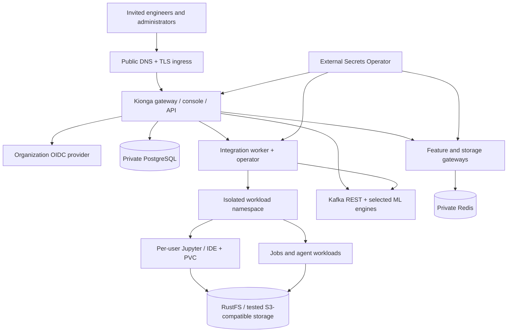

# First-iteration deployment plan

> Proposed rollout for a small, invited engineering team—not a record of a live
> installation or a production certification. The initial cloud target is Amazon
> EKS. The same Helm package has GKE and AKS overlays, but each provider needs
> its own staging acceptance run. Replace every example hostname, image digest,
> endpoint, account ID, and policy before applying anything.

## 1. Goal and release boundary

The first iteration should let an administrator sign in, grant two or three
engineers bounded access, and let those engineers create projects, open isolated
workspaces, work in Jupyter/IDE, run a controlled job or pipeline, and inspect
its outputs. Expose it to **invited users only** after the acceptance tests
below. Do not call the installation production-ready merely because Helm reports
success.

Use [managed Kubernetes](managed-kubernetes.md) for this iteration. The
[public VM package](public-vm.md) runs the gateway and TLS edge, **not** the
per-user workload plane. It is useful for a gateway-only demonstration, but
cannot demonstrate the complete team workspace and Kubernetes job experience.
The local Compose stack remains a development and release-smoke environment,
not the Internet-facing team deployment.

### In scope

- HTTPS console/API, enterprise OIDC, one administrator, and invited normal users.
- Existing user/service/resource grants and project isolation, with real
  server-side denial tests.
- Per-user Jupyter/IDE workspaces with persistent volumes and separate-origin
  browser access.
- Project creation, Git metadata, controlled scaffolding, model/artifact
  registration, and a small agent or pipeline demonstration using configured
  engines.
- PostgreSQL, Redis, RustFS-compatible S3 object storage, Kafka REST, selected
  ML engines, external secrets, ingress, logs, metrics, and backups.

### Explicitly not promised in iteration one

- A separately authenticated admin portal; the current administrator uses the
  existing console and RBAC. The [separate-session work](https://github.com/kiongahq/platform/issues/27)
  and [admin-portal work](https://github.com/kiongahq/platform/issues/28) are
  tracked separately.
- General hosted web applications, dashboards, and multi-port endpoints; those
  are [planned](https://github.com/kiongahq/platform/issues/29).
- Framework-neutral agents as a completed product. The bundled path is
  LangGraph; Agno and NOOA adapters are opt-in, with different persistence,
  streaming, and safety properties. Do not enable generated-code execution
  without an independently reviewed sandbox.
- A certified multi-tenant security boundary for arbitrary untrusted code.
  Namespace RBAC and restricted pods alone do not provide that.
- Every external engine being installed by the Kionga chart. The chart expects
  the dependencies you select to exist and be operated separately.

The [implementation-status matrix](../reference/implementation-status.md) is
the source for bundled, optional, unverified, and planned capabilities.

## 2. Revised architecture



Deploy the Kionga control plane and user workloads in separate namespaces.
Put databases, object storage, Kafka/REST, and ML engines behind private
network paths. Use a distinct, restricted workload identity for each service.
Do not expose an engine, database, object-store console, or Kubernetes API
through the public Kionga ingress.

For iteration one, prefer managed PostgreSQL and Redis and an independently
operated, backed-up RustFS deployment. The Helm chart does **not** provision
RustFS, Kafka, Kafka REST, MLflow, Prefect, Langfuse, or an OIDC provider.
If you choose another S3-compatible service, prove compatibility with Kionga's
storage proxy and artifact clients before treating it as interchangeable.
An external Kafka service still needs a reachable Kafka REST endpoint.

## 3. Hosting strategy and minimum topology

| Layer | First-iteration choice | Ownership and validation |
| --- | --- | --- |
| Cloud and cluster | EKS with managed EC2 node groups, three Ready nodes across at least two Availability Zones | Provision VPC/subnets, private nodes, EKS API access, node capacity, add-ons, budgets, and IAM before Helm. Start without a GPU pool unless an accepted use case needs it. |
| Ingress and DNS | One console hostname and wildcard workspace hostname under the same registrable site | Install an ingress controller, DNS automation or records, public TLS and wildcard TLS; prove actual WebSocket, iframe-cookie and Host-header behavior. |
| Persistent workspace files | Encrypted, expandable EBS CSI StorageClass and one PVC per workspace | EBS is zonal/RWO; do not present it as shared cross-zone storage. Test snapshot and restore. |
| Durable application data | Private PostgreSQL with verified TLS, backups/PITR, and a separate recovery owner | Test migrations and restore, not only connectivity. Keep the credential-encryption key with recoverable secret backups. |
| Cache/online features | Private Redis with authentication and recovery plan | Apply tenant-aware access boundaries and measure memory. |
| Artifacts and datasets | Private RustFS or a tested S3-compatible endpoint | Back up/version object data, test reads/writes and presigned access, and restrict bucket credentials. Kionga does not install a durable RustFS cluster. |
| Events and engines | Kafka + Kafka REST; add MLflow/Prefect and others only when their demo path is selected | Pin engine versions, create required topics, secure each endpoint, and monitor lag/failures. |
| Identity and secrets | Organization OIDC + cloud secret manager + External Secrets Operator | OIDC issuer for user login is **not** EKS's IAM OIDC issuer. Scope secret-reader identity to the needed secrets. |
| Observability | Existing metrics/logging stack with alert routing | Collect gateway, operator, worker, ingress, pod, storage, DB, and Kafka events; exercise an alert in staging. |

The chart defaults to three gateway replicas and two each of the operator,
integration worker, feature gateway, storage proxy, and trace proxy. Size nodes
from **their requests plus system add-ons, engines, and expected simultaneous
workspaces**. Do not pick instance types from a generic minimum and assume
capacity. Establish an AWS budget and alert before provisioning; EKS, nodes,
load balancers, EBS, database, storage, logs, and egress all contribute to cost.
Current prices and supported Kubernetes versions should be checked in AWS at
purchase time.

For EKS, enable and verify VPC CNI NetworkPolicy enforcement explicitly. AWS
documents that default startup enforcement can temporarily allow traffic before
policies attach; review strict-startup mode and test required DNS/API paths.
Install the EBS CSI add-on and its IAM permissions. Use an IAM role for the
External Secrets service account, scoped to the relevant secret ARN; do not
reuse the cluster bootstrap role for application workloads.

## 4. Release inputs and repository structure

```text
kionga/
├── deploy/                 # Helm chart, provider overlays and scripts
├── platform/               # Gateway, operator and console
├── workspace/              # Jupyter/IDE images and scaffolder
├── agent-runtime/          # Optional agents
├── pipeline-runner/        # Local/trusted execution path
├── serving/                # Model serving integration
├── trace-proxy/            # Model/agent telemetry
├── sdk-python/
├── contracts/
└── docs/
```

Build/test each component at a known commit. Publish immutable OCI images,
review their provenance/SBOMs and vulnerability results, then put
`repository@sha256:DIGEST` references in a reviewed non-secret Helm values
overlay. The [production example](https://github.com/kiongahq/deploy/blob/main/helm/production.example.yaml)
contains `REPLACE` values; it is not a deployable release. The gateway,
operator, worker, feature gateway, storage proxy, trace proxy, Jupyter, and IDE
images are required for the documented chart path. Verify each registry
artifact exists for the target CPU architecture before starting a rollout.

Keep non-secret values in a reviewed release repository or GitOps overlay.
Keep credentials in the cloud secret manager—not in `.env`, Helm
`--set`, checked-in YAML, CI logs, or a shell command line. Use
`deploy/helm/production.example.yaml` and
`deploy/helm/providers/eks.example.yaml` as templates. Configure at least:

- Actual hostnames, TLS Secret names, ingress class and controller namespace.
- `OIDC_ISSUER`, `OIDC_JWKS_URL`, authorization/token URLs,
  `OIDC_AUDIENCE`, client ID, exact callback and allowed origin.
- Private PostgreSQL, Redis, Kafka REST, RustFS/S3, and selected engine URLs.
- `storageClass: kionga-ebs-gp3` through the provider overlay, bounded
  workspace quota, and named image digests.
- External Secrets mappings for gateway, feature gateway, and storage proxy;
  add optional engine credentials to both the corresponding ExternalSecret
  and component secret list.
- Reviewed egress CIDRs/ports, including Kubernetes API, DB, IdP, Kafka REST,
  storage and engines. Do not leave the documentation CIDR or globally allow
  external traffic.

For example, the non-secret part of a staging overlay should be shaped like
this. It is **illustrative, incomplete, and not safe to apply unchanged**:

```yaml
images:
  gateway: ghcr.io/kiongahq/gateway@sha256:REPLACE
  operator: ghcr.io/kiongahq/operator@sha256:REPLACE
  integration-worker: ghcr.io/kiongahq/integration-worker@sha256:REPLACE
  feature-gateway: ghcr.io/kiongahq/feature-gateway@sha256:REPLACE
  storage-proxy: ghcr.io/kiongahq/storage-proxy@sha256:REPLACE
  trace-proxy: ghcr.io/kiongahq/trace-proxy@sha256:REPLACE
  jupyter: ghcr.io/kiongahq/jupyter@sha256:REPLACE
  ide: ghcr.io/kiongahq/ide@sha256:REPLACE
ingress:
  className: REPLACE
  host: console.example.com
  tlsSecretName: kionga-tls
  controllerNamespace: ingress-system
workspaceIngress:
  enabled: true
  baseDomain: workspaces.example.com
  tlsSecretName: kionga-workspace-tls
config:
  MLAIOPS_ALLOWED_ORIGIN: https://console.example.com
  OIDC_REDIRECT_URL: https://console.example.com/auth/callback
  OIDC_ISSUER: https://identity.example.com/realms/kionga
  OIDC_AUDIENCE: REPLACE
  OIDC_CLIENT_ID: REPLACE
  OIDC_JWKS_URL: https://identity.example.com/realms/kionga/certs
  OIDC_AUTH_URL: https://identity.example.com/realms/kionga/auth
  OIDC_TOKEN_URL: https://identity.example.com/realms/kionga/token
  KIONGA_WORKSPACE_BASE_DOMAIN: workspaces.example.com
  KAFKA_REST_URL: https://kafka-rest.internal.example.com
  MLFLOW_URL: https://mlflow.internal.example.com
  PREFECT_API_URL: https://prefect.internal.example.com/api
  S3_ENDPOINT: https://rustfs.internal.example.com
```

The complete production example also specifies ExternalSecrets, monitoring,
NetworkPolicy, quotas and other values. Use only URLs from the actual OIDC
provider's discovery document; the paths above are placeholders, not universal
OIDC endpoints. The EKS provider overlay selects the StorageClass.

The gateway needs `DATABASE_URL` with PostgreSQL `sslmode=verify-full`,
`OIDC_CLIENT_SECRET`, `MLAIOPS_INTERNAL_TOKEN`, and a stable 32-byte
base64 `KIONGA_CREDENTIAL_KEY`. Feature and storage gateways need their own
listed keys. Secret files are read at process startup: rotate by updating the
secret and rolling out consumers deliberately. The internal token is shared
service authentication, not per-workload mTLS.

## 5. Phased deployment runbook

### Phase 0 — Local release candidate

1. Pick and record component commits and compatible image digests.
2. Run tests against those commits; from the workspace root:

   ```bash
   make -C platform verify
   make -C deploy test
   make -C docs docs-build
   make -C deploy local-up
   make -C deploy smoke
   ```

3. Review the smoke report's **skips**. An optional engine being skipped is
   not evidence that it works. Fix failures before staging.
4. Record the exact image digests, schema migration state, test results,
   owner, rollback revision and release notes.

### Phase 1 — Private EKS staging

1. Create/select the cluster and private node groups. Verify the VPC CNI,
   CoreDNS, metrics-server, EBS CSI, NetworkPolicy enforcement, encrypted
   expandable StorageClass, and volume snapshots.
2. Provision private PostgreSQL, Redis, object storage, Kafka REST, selected
   ML engines, OIDC, ingress, TLS, monitoring, and the cloud secret manager.
3. Bootstrap the namespace and CRDs with a privileged bootstrap identity:

   ```bash
   aws eks update-kubeconfig --name CLUSTER --region REGION --alias kionga-eks
   kubectl --context kionga-eks create namespace kionga-system
   kubectl --context kionga-eks label namespace kionga-system pod-security.kubernetes.io/enforce=restricted
   kubectl --context kionga-eks apply -f deploy/config/crd/
   ```

4. Install External Secrets Operator separately. Replace the placeholders in
   `deploy/helm/secretstore-aws.example.yaml`, configure the narrow IAM
   trust/permission policy, apply the namespace-scoped SecretStore, and wait
   for the required Kubernetes Secrets to sync.
5. Apply the reviewed EBS StorageClass example and run the provider preflight:

   ```bash
   kubectl --context kionga-eks apply -f deploy/helm/providers/eks-storageclass.example.yaml
   python3 deploy/scripts/cloud-preflight.py eks \
     --context kionga-eks --cluster CLUSTER --region REGION
   ```

6. Render, inspect, then apply the chart. Use a protected, non-secret
   `/secure/production.yaml` containing real hosts, endpoints and digests:

   ```bash
   helm lint deploy/helm/kionga -f /secure/production.yaml \
     -f deploy/helm/providers/eks.example.yaml \
     --namespace kionga-system --strict
   bash deploy/scripts/deploy-kubernetes.sh kionga-eks kionga-system \
     /secure/production.yaml deploy/helm/providers/eks.example.yaml
   bash deploy/scripts/deploy-kubernetes.sh kionga-eks kionga-system \
     /secure/production.yaml deploy/helm/providers/eks.example.yaml --apply
   kubectl --context kionga-eks -n kionga-system get pods,services,ingress,hpa,pdb
   kubectl --context kionga-eks -n kionga-system get externalsecrets
   ```

7. Inspect each failed condition, rather than retrying blindly. Check image
   pulls, PVC binding, DNS/TLS, secret sync, OIDC callback, network-policy
   egress and upstream engines. The deployment script checks prerequisites
   and waits for gateway rollout; it does not perform all application tests.

The chart's Kubernetes pipeline executor is **off by default** and has not
been validated on a live cluster. Do not enable it for invited users until
the namespace, RBAC, pod logs, failure semantics, and quota behavior pass
staging tests. Likewise, an external Prefect/KFP URL alone does not install or
validate a runnable execution worker.

### Phase 2 — Acceptance and limited invite

Run the read-only verifier with protected token files, then perform the
stateful tests in [production operations](production-operations.md):

```bash
python3 deploy/scripts/verify-production.py \
  --context kionga-eks --namespace kionga-system \
  --origin https://console.example.com \
  --workspace-host https://workbench-0123456789abcdef0123456789abcdef.workspaces.example.com \
  --admin-token-file /secure/admin-id-token \
  --user-token-file /secure/user-id-token \
  --forbidden-project PROJECT_ID --expect-monitoring
```

The ID-token files are protected test inputs; do not print them or pass tokens
as command arguments. Add `--test-workspace-handoff` only when ready to
create/revoke a temporary session. The wildcard hostname shown is illustrative;
use an actual issued workspace host.

Then test one complete path: admin grants a small resource profile to a normal
user; the user signs in, creates a project, opens Jupyter and IDE, restarts the
workspace without losing files, runs a controlled job, stores and retrieves an
artifact, and views logs. Test a second user, unprovisioned user and suspended
user against both UI and direct APIs. Require a real denial for cross-project
data, excess CPU/memory/storage, and revoked workspace access.

Invite a small team only after backup restore, one-node loss, dependency
outage, secret rotation, log/alert routing and rollback have been exercised in
staging. Use synthetic/non-sensitive data for the first external pilot.

### Phase 3 — Expand after measured evidence

Add dedicated GPU nodes, more engine integrations, larger quotas and more
organizations only when pilot demand and resource metrics justify them.
Prioritize framework-neutral agents, separate admin sessions, general web apps
and multi-port routes according to their tracked issues. Re-run acceptance
for every new cloud provider and for every trust-boundary change.

## 6. Operations, recovery and release gates

| Gate | Evidence required before inviting users |
| --- | --- |
| Identity | Real OIDC login/logout; admin and normal-user claims; unknown, suspended and cross-project denial at API level. |
| Workspaces | Per-user launch, separate-origin cookie/host isolation, WebSocket/Jupyter/IDE operation, revoke, restart and PVC persistence. |
| Execution | One selected job/pipeline engine actually runs an image and exposes node status/logs; no Docker socket in untrusted user pods. |
| Storage | Read/write and restore of workspace PVC and object artifacts; bucket credentials scoped; backup owner and retention recorded. |
| Availability | Node drain and replica failure tested; external DB/Redis/Kafka/storage outages produce alerts and recover without unsafe fallback. |
| Security | NetworkPolicy enforcement proved with denied traffic; signed/reviewed image digests; secrets not in Helm values/logs; roles scoped. |
| Monitoring | Ingress/gateway/worker/operator/engine logs and metrics visible; at least one alert deliberately fired and routed to an owner. |
| Release | Migration tested on backup; old Helm revision and image digests retained; rollback limitations documented. |

Set a pilot RPO/RTO **before** real user data is stored (for example, an
organization-approved recovery-point target in hours and recovery-time target
within a business day). Prove them with a restore into a separate environment.
Helm rollback changes manifests; it does not roll back database schema, CRDs,
objects or secrets. Keep the credential-encryption key in the recovery plan.

Operate with an on-call owner, a daily deployment-health review during the
pilot, and a small incident log. Track ingress 5xx/latency, gateway readiness,
worker polling, reconciliation errors, Kafka lag, PVC usage, database capacity,
certificate expiry, secret sync and cloud spend. Record every exception with
an owner and deadline instead of treating a green dashboard as full readiness.

## 7. Risks and decisions

1. **Scope versus cost.** This is a distributed platform, not a free-tier web
   app. EKS, three nodes, ingress, storage, managed state and monitoring have
   recurring cost. If the budget is too high, run a gateway-only VM demo or a
   local Compose evaluation; do not label either a complete team deployment.
2. **External dependencies.** Kionga's Helm chart does not create RustFS,
   Kafka REST, OIDC, MLflow or Prefect. Each needs a named owner, security
   configuration and backup/upgrade plan.
3. **Unverified paths.** Kubernetes pipeline execution and some integrations
   have fake-client/local evidence, not a live cluster acceptance record.
   Qualify them in staging before making them part of the pilot promise.
4. **Browser and tenant boundaries.** Workspaces execute user code. Separate
   origins, live grant checks, strict egress and secret minimization must be
   tested with a real ingress/browser. Do not assume pod security alone is a
   complete sandbox.
5. **Data durability.** EBS is zonal and RustFS is not installed by the chart.
   Workspace snapshots, object backups and database PITR need independent
   restore tests.
6. **Upgrade safety.** Immutable images and atomic Helm upgrade do not make
   schema downgrades safe. Review compatibility and retain backups before
   every release.

**Decision:** deploy a private EKS staging installation first, qualify one
complete user workflow and its recovery/security boundaries, then invite a
small team. Keep the public VM path as a limited gateway-only demonstration.

## 8. Implementation and provider references

- Kionga: [managed Kubernetes](managed-kubernetes.md),
  [Amazon EKS](providers/aws-eks.md),
  [production operations](production-operations.md),
  [implementation status](../reference/implementation-status.md).
- AWS: [EKS NetworkPolicy enforcement](https://docs.aws.amazon.com/eks/latest/userguide/cni-network-policy-configure.html),
  [EBS CSI](https://docs.aws.amazon.com/eks/latest/userguide/ebs-csi.html),
  [IAM OIDC provider for service-account roles](https://docs.aws.amazon.com/eks/latest/userguide/enable-iam-roles-for-service-accounts.html).
- External Secrets: [AWS Secrets Manager provider](https://external-secrets.io/latest/provider/aws-secrets-manager/).
- Kubernetes: [Secret security practices](https://kubernetes.io/docs/concepts/security/secrets-good-practices/).
