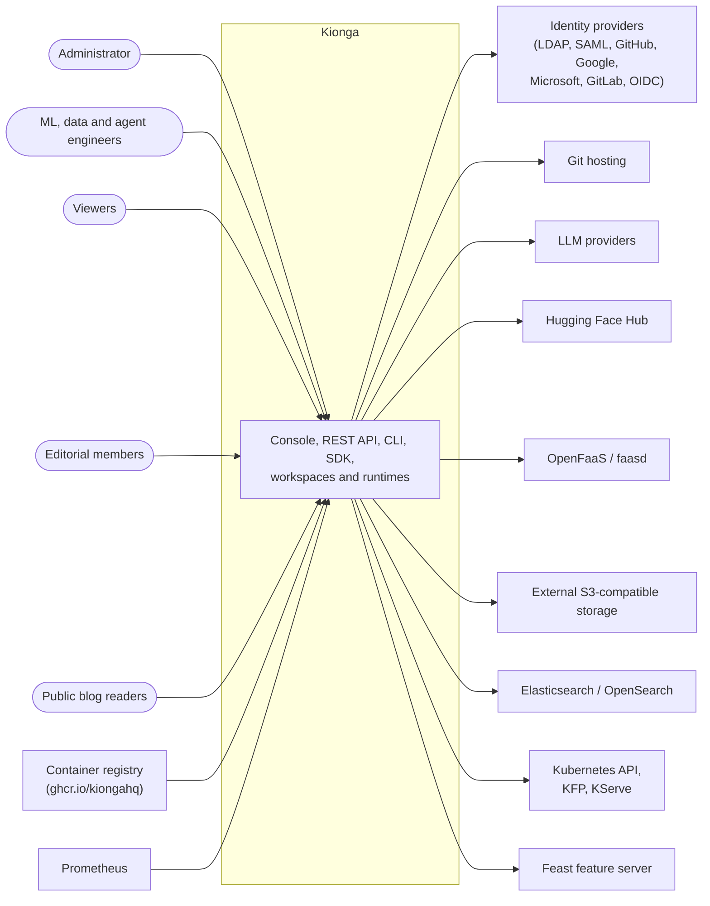

# 3. Context and scope

Kionga's boundary is the set of services in the Kionga repositories. The engines it
bundles in Compose (PostgreSQL, Redis, Kafka, RustFS, MLflow, Prefect, Langfuse, Dex)
are inside the boundary for a local installation and outside it on Kubernetes, where
the Helm chart expects them to exist already. This page treats them as part of the
system and lists everything else as external.

## Business context

| Partner | What crosses the boundary |
| --- | --- |
| Administrators | Access grants, quotas, policies, connections, user and access-request review |
| Engineers | Projects, pipeline definitions and runs, models, features, agents, tools, functions; workspace sessions |
| Viewers | Read-only views of projects, runs, logs and features |
| Editorial members | Draft, review, schedule and publish engineering posts in the separate editorial workspace |
| Public blog readers | Published posts, media and the landing page, without signing in |
| Identity providers | Sign-in through Dex connectors, or a direct OIDC issuer; Kionga receives an ID token with subject, email, groups and the connector used |
| Git hosting | Repository metadata on projects (credential-free HTTPS or SSH URLs); source is pushed and pulled from inside workspaces |
| LLM providers | Chat-completion calls from agents: OpenAI-protocol backends through the trace proxy, the `anthropic` backend directly |
| Hugging Face Hub | Model search and pinned-commit downloads; a connected account token is stored encrypted with `KIONGA_CREDENTIAL_KEY` |
| Container registry | Kionga's images, pulled with registry credentials because the packages are private |
| OpenFaaS or faasd | Project-owned function deployment and invocation, and function DAG steps, when `OPENFAAS_URL` is set |
| External S3-compatible storage | Object storage connections with a signed `HEAD` health check, for installations that do not use the bundled RustFS |
| Elasticsearch or OpenSearch | Structured log export from the optional `log-exporter` |
| Kubernetes API, KFP, KServe | Custom resources, workspace and agent workloads, pipeline Jobs, KFP runs and KServe `InferenceService` objects on the scale path |
| Feast feature server | Online feature lookups when the feature gateway runs with `FEAST_URL` |
| Prometheus | Scrapes the metrics collector and the gateway's optional metrics listener |

## Technical context

| Channel | Protocol and format | Endpoints in Kionga |
| --- | --- | --- |
| Browser to console and API | HTTP or HTTPS, JSON; Server-Sent Events for live updates | Gateway `:8080`, behind Caddy or an Ingress on servers and clusters |
| API clients (SDK, CLI, scripts) | HTTP JSON with a bearer credential: an OIDC token, a personal API key (`nxs_` prefix), or the internal service token | `/api/v1/*`; the machine-readable description is `/api/openapi.json` |
| Sign-in | OIDC authorization code flow with PKCE (S256), state and nonce; ID tokens verified against the issuer's JWKS | `/auth/login`, `/auth/sso/login`, `/auth/callback`; Dex `:5556` locally |
| Workspace traffic | HTTP and WebSocket through the gateway (`/workspaces/`), or a separate per-workspace host on Kubernetes | Jupyter `:8888` and code-server inside the Compose network; per-user Services on Kubernetes |
| Object storage | S3 API with AWS SigV4, path-style addressing, presigned URLs | `objectstore:9000`; the storage proxy holds the credentials |
| Events | Kafka REST proxy v2 (JSON envelopes) over HTTP | `kafka-rest:8082`; topics listed in [components: data plane](../components/data-plane.md#kafka-and-kafka-rest) |
| LLM egress | OpenAI-compatible HTTP reverse proxy | Trace proxy `:8081` |
| Model inference | MLflow scoring protocol, `POST /invocations` | One `mlflow models serve` container per deployed model |
| Container control | Docker Engine API over the Unix socket | Serving manager and pipeline runner only |
| Kubernetes control | Kubernetes API through client-go and controller-runtime | Operator, integration worker, gateway (workspace discovery and the opt-in Job executor) |
| Metrics | Prometheus text exposition | Metrics collector `:9090`; the gateway when `METRICS_PORT` is set |

Exact ports, host bindings and in-stack hostnames are in the product
[services and ports reference](https://kiongahq.github.io/docs/reference/services/).
