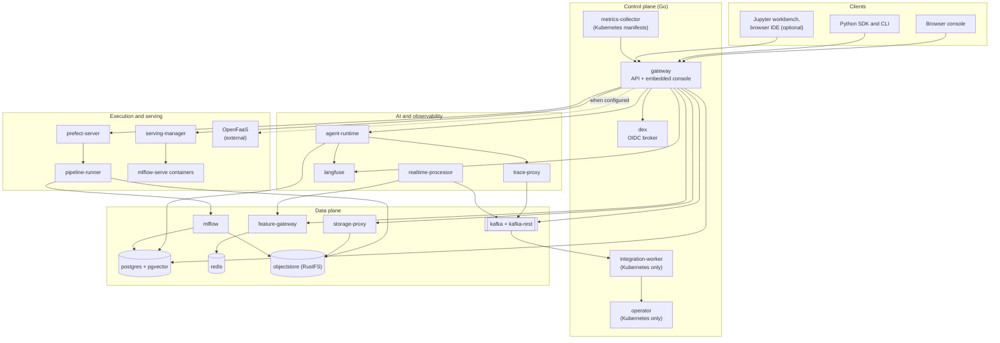
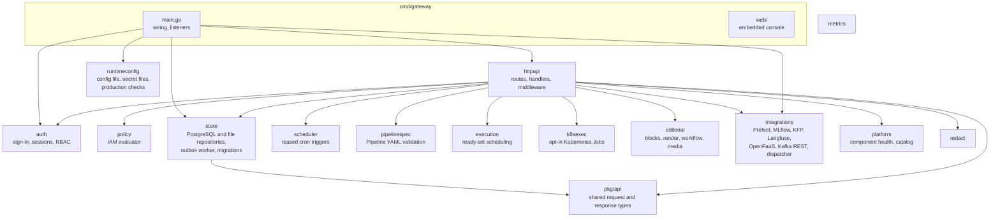

# 5. Building block view

This section decomposes Kionga in two levels. Level 1 shows the whole system as
services. Level 2 opens the platform control plane. Each building block links to its
[component page](../components/index.md), which holds the interfaces, configuration,
code map and tests.

## Level 1: the system

| Building block | Responsibility | Repository | Details |
| --- | --- | --- | --- |
| gateway | REST API, embedded console, sign-in, authorization, persistence, audit and outbox, scheduler, orchestration of every engine | `platform` | [Gateway and control plane](../components/gateway.md) |
| `dex` | OIDC broker in front of LDAP, SAML, GitHub, Google, Microsoft, GitLab and OIDC connectors | upstream image, configured in `deploy` | [Gateway and control plane](../components/gateway.md#dex) |
| operator | Reconciles Kionga custom resources into workspaces, agents, pipeline runs and model promotions | `platform` | [Gateway and control plane](../components/gateway.md#operator) |
| integration-worker | Consumes lifecycle commands from Kafka and creates or updates custom resources | `platform` | [Gateway and control plane](../components/gateway.md#integration-worker) |
| metrics-collector | Prometheus exposition of platform metrics; deployed by the Kubernetes manifests in `deploy/config/deploy`, not by Compose or the Helm chart | `platform` | [Gateway and control plane](../components/gateway.md#metrics-collector) |
| `postgres`, `redis`, `kafka`, `kafka-rest`, `objectstore`, `mlflow` | Durable state, online features, events, objects, experiments and the model registry | upstream images, configured in `deploy` | [Data plane](../components/data-plane.md) |
| feature-gateway, storage-proxy | Online feature lookups; the only holder of object-store credentials | `platform` | [Data plane](../components/data-plane.md) |
| `prefect-server`, pipeline-runner | Pipeline execution engine and the flows it runs | upstream image; `pipeline-runner` | [Execution and serving](../components/execution.md) |
| serving-manager | Starts one `mlflow models serve` container per deployed model | `serving` | [Execution and serving](../components/execution.md#serving-manager) |
| agent-runtime, `realtime-processor`, feature-materializer | Agent serving, Kafka stream demos, one-shot feature materialization | `agent-runtime` | [AI and observability](../components/ai-observability.md) |
| trace-proxy | OpenAI-compatible LLM egress that publishes a trace event per call | `trace-proxy` | [AI and observability](../components/ai-observability.md#trace-proxy) |
| `langfuse` | LLM and agent observability, prompt management | upstream image | [AI and observability](../components/ai-observability.md#langfuse) |
| `jupyter`, `ide` | Development workbench and browser IDE; `kionga` workspace CLI and sidecar | `workspace` | [Workspace](../components/workspace.md) |
| SDK | Typed client, agent memory and checkpoints, LLM factory, tools, tracing, pipeline compiler | `sdk-python` | [Python modules](../components/python-modules.md) |
| contracts | Versioned JSON Schema for `kionga.dev/v1 Pipeline` | `contracts` | [Contracts repository](../components/contracts.md) |

The `deploy` repository contains no service code. It composes these blocks into the
three [deployments](07-deployment-view.md).

## Level 2: the platform control plane

The `platform` repository is one Go module, `github.com/kiongahq/platform`, with eight
commands under `platform/go/cmd` and the shared logic under `platform/go/internal`.
The gateway binary links most packages; the other commands each use a few.

| Package | Responsibility | Used by |
| --- | --- | --- |
| `httpapi` | Route table on the standard library `ServeMux`, handlers, the middleware chain (`logging`, `securityHeaders`, `cors`, RBAC), JSON helpers, OpenAPI document, SSE digest | gateway |
| `auth` | OIDC/JWKS verification, the sign-in `Authenticator`, local and single sign-on sessions, personal API keys, RBAC and `Allowed` | gateway |
| `policy` | Pure IAM evaluator: default deny, explicit deny wins, `kionga:` resource patterns, conditions; managed role baselines | gateway |
| `store` | `Repository` interface with a PostgreSQL implementation (transactions, row-level security, outbox) and a local JSON file implementation; embedded SQL migrations | gateway, log-exporter, CLI |
| `scheduler` | Cron and timezone triggers under a PostgreSQL lease; at most one run per slot | gateway |
| `pipelinespec`, `execution`, `k8sexec` | Parse and validate `kionga.dev/v1 Pipeline` YAML; ready-set scheduling; run nodes as Kubernetes Jobs when enabled | gateway; the CLI through `httpapi` |
| `editorial` | Engineering blog: block validation, sanitized rendering, revisions, workflow, media pipeline | gateway |
| `integrations` | HTTP clients for external engines; the Kafka REST consumer; the lifecycle dispatcher and worker | gateway, operator, integration-worker |
| `operator` | controller-runtime reconcilers for agents, workspaces, pipeline runs, model promotions, tools and connections | operator |
| `feature`, `storage` | Feature store adapters and HTTP handlers; SigV4 presigned URLs, browse and preview | feature-gateway, storage-proxy, and the gateway for connection checks |
| `metrics`, `logexport`, `redact`, `runtimeconfig`, `platform` | Platform metrics; Elasticsearch and OpenSearch export; secret redaction in logs; configuration loading and production checks; live component health and catalog | several |

The [Go packages](../components/go-packages.md) page lists files and tests for each
package.

### Gateway request path

Every request passes the same chain, outermost first:

1. `WorkspaceHostRouter`, only in production with `KIONGA_WORKSPACE_BASE_DOMAIN` set:
   requests for a workspace host never reach the console or auth routes.
2. `APITokenMiddleware`: a bearer token starting with `nxs_` resolves to a personal
   API key principal with that key's services and projects.
3. `Authenticator`: serves `/auth/*`, lets public paths through, and otherwise
   identifies the caller (internal service token, OIDC bearer token, local session,
   single sign-on session) or answers `401` for `/api/` and redirects to sign-in for
   pages.
4. `logging`, `securityHeaders`, `cors`.
5. `RBACWithResolver`: loads the administrator-managed access profile for the
   subject and applies `Allowed`.
6. The route handler, which applies project scoping and, for the covered actions, the
   IAM policy decision.

[Section 8](08-crosscutting-concepts.md#security-and-identity) explains each step.
