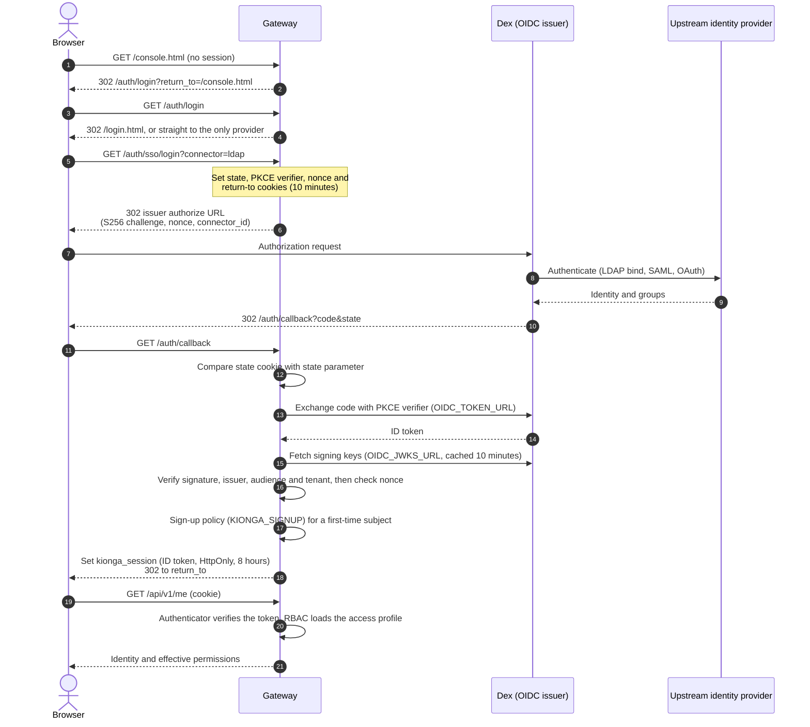
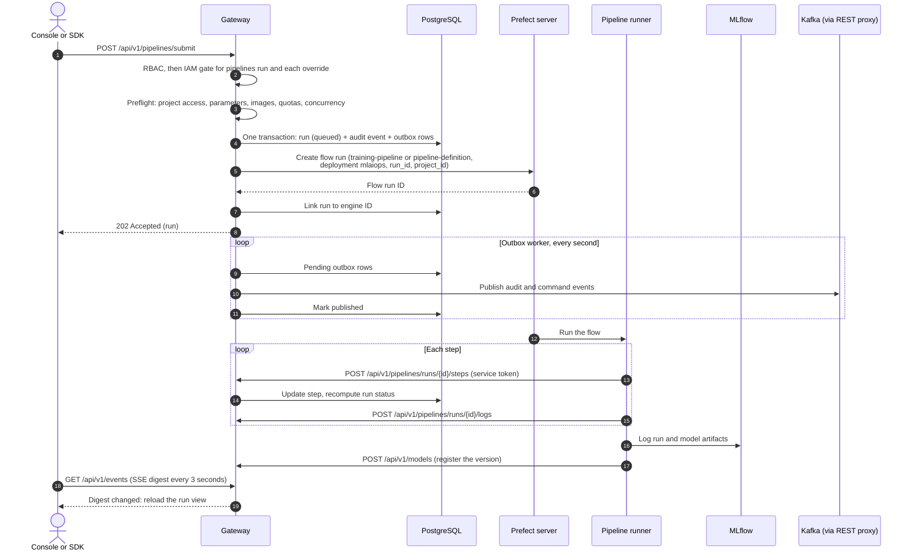
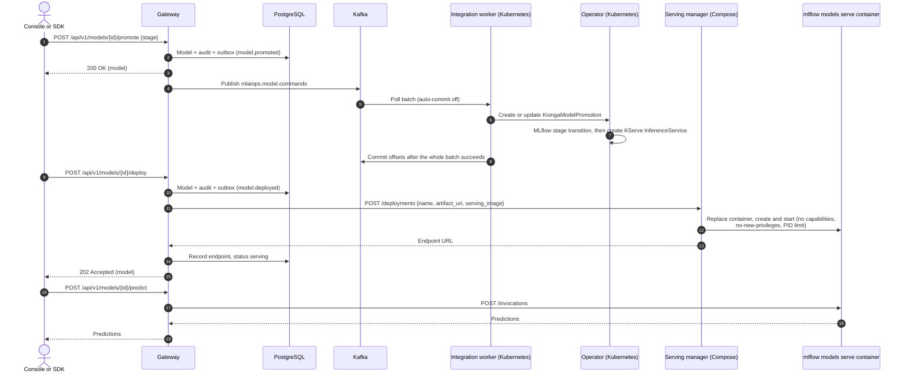
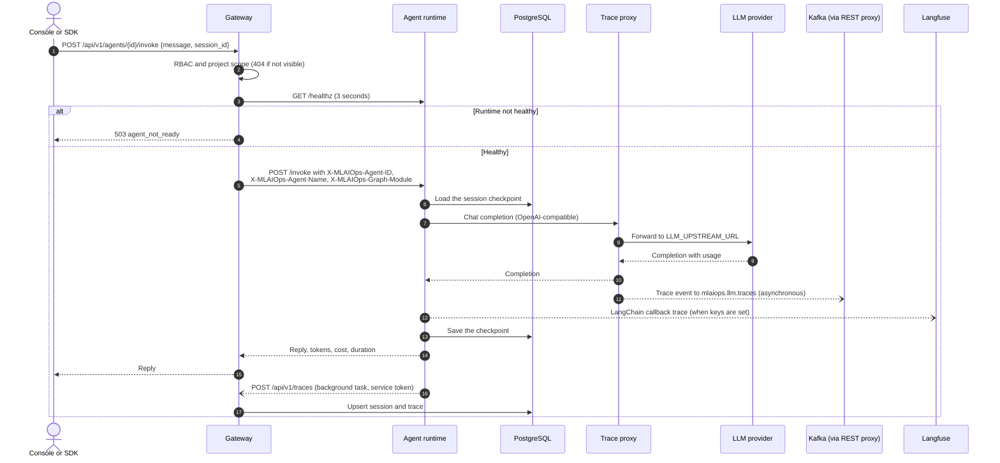

# 6. Runtime view

Four scenarios cover the paths that matter most: how a person signs in, how a
pipeline runs, how a model is promoted and served, and how an agent turn is executed
and traced. Each step names the route or function that implements it, so you can
follow it in the code.

## Sign-in through single sign-on

The gateway runs the OIDC authorization code flow against the configured issuer (Dex
in the local stack). The implementation is `platform/go/internal/auth/session.go` and
`platform/go/internal/auth/authenticator.go`.

What to know:

- The callback host decides where the login cookies live. If the browser starts on a
  different host (for example `127.0.0.1` while the callback is `localhost`), the
  gateway first redirects to the callback's host.
- `KIONGA_SSO_GROUP_ROLES` maps identity-provider groups to platform roles. A signed-in
  subject with no mapped group and no access profile gets the `user` role and reaches
  only `/api/v1/me`, access requests and personal settings until provisioned.
- The session cookie is `Secure` when the callback URL is HTTPS. Production refuses a
  plain-HTTP `OIDC_REDIRECT_URL`.
- Local accounts use `/auth/local/login` instead. The gateway checks a `bcrypt` hash
  (or the bootstrap administrator from `MLAIOPS_LOCAL_USERNAME` and
  `MLAIOPS_LOCAL_PASSWORD`), throttles per account after five failures, and issues an
  in-memory session cookie `kionga_local_session` for eight hours.
- `/auth/logout` ends both kinds of session and revokes the subject's workspace
  sessions.

## Pipeline run

This is the Compose path, where Prefect executes the run. Handlers are in
`platform/go/internal/httpapi/server.go` (`submitPipeline`) and
`platform/go/internal/httpapi/pipeline_dispatch.go` (`dispatchPipeline`); the flows
are in the `pipeline-runner` repository.

Variations:

- **Engine missing.** Without `PREFECT_API_URL` the run is recorded and immediately
  marked failed at the `submit-to-engine` step with an explanation. It is never left
  queued as if work were pending.
- **Function DAGs.** A definition in `functions` mode runs through OpenFaaS. The gateway
  executes ready jobs from a `goroutine` started by the submit request. Without
  OpenFaaS, every job is marked failed with the reason.
- **Kubernetes Jobs.** With the opt-in Kubernetes executor, container definitions run
  as one hardened Job per node attempt instead of through Prefect.
- **Kubernetes lifecycle path.** The outbox also carries `mlaiops.pipeline.commands`.
  On Kubernetes the integration worker turns it into a `KiongaPipelineRun`, and the
  operator submits that run to KFP.

## Model promotion and serving

Promotion changes the model's stage; deployment starts a live endpoint. Locally the
serving manager runs containers on the Docker host. On Kubernetes, promotion also
drives MLflow and KServe through the operator.

Failure behavior: if the serving manager rejects the deployment or is unreachable, the
gateway records status `failed` and returns `502 serving_failed`. A prediction for a
model without a live endpoint returns `409 not_serving`. Rollback removes the serving
container on a best-effort basis and logs a failed removal.

## Agent turn with trace capture

The gateway proxies a turn to the agent runtime after a readiness gate. The runtime
calls the model through the trace proxy and reports the session back.

What to know:

- The runtime endpoint is `AGENT_RUNTIME_URL` in Compose (one shared runtime). On
  Kubernetes it is the per-agent Service named from the immutable agent ID in
  `MLAIOPS_AGENT_NAMESPACE`.
- Token counts come from the model's usage metadata, never from an estimate. Cost is
  computed from `MLAIOPS_COST_PER_1K_INPUT` and `MLAIOPS_COST_PER_1K_OUTPUT`.
- The trace proxy's event carries the agent, version, session ID, HTTP status and
  duration, not the prompt or the provider key. It is sent from a `goroutine` after the
  response, and a failed send is dropped.
- The `anthropic` backend calls Anthropic directly and does not pass through the trace
  proxy. The default `mock` backend makes no network call.
- Session reporting is best effort: `record_trace` in the SDK uses a two-second
  timeout and ignores HTTP errors, so observability never fails a turn.
