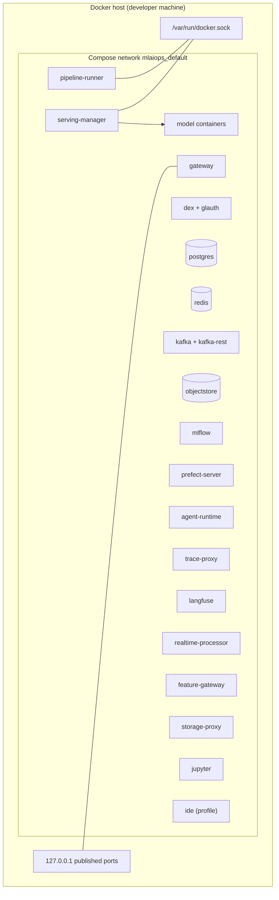
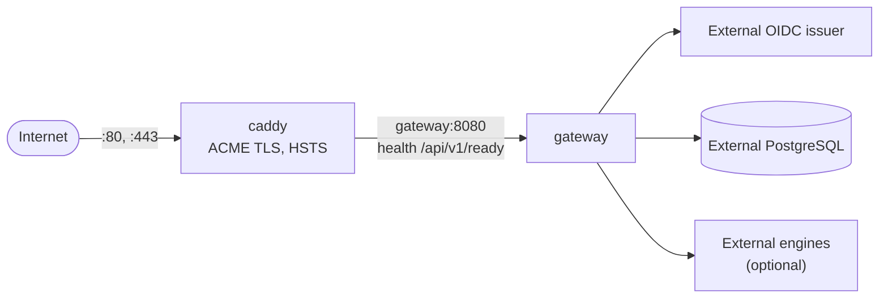
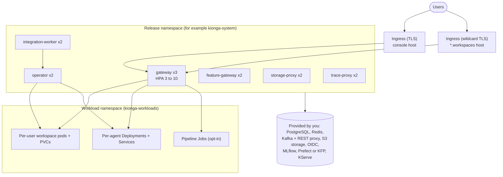

# 7. Deployment view

Kionga has three deployments. They share images and contracts but differ in what
they include and what they expect you to provide. The operator-facing procedures are
in the product documentation: [run locally](https://kiongahq.github.io/docs/operations/local/),
[single server](https://kiongahq.github.io/docs/operations/public-vm/) and
[deploy on Kubernetes](https://kiongahq.github.io/docs/operations/managed-kubernetes/).

| | Local Compose | Single server | Kubernetes through Helm |
| --- | --- | --- | --- |
| Definition | `deploy/compose.yaml` | `deploy/vm/compose.yaml`, `deploy/vm/up.py` | `deploy/helm/kionga`, `deploy/config/crd/` |
| Images | Built from sibling checkouts | Released images pinned by digest | Released images pinned by digest |
| Includes | Every bundled service and engine | Gateway and Caddy only | Six platform Deployments; no data stores or engines |
| Identity | Dex with a test LDAP directory, plus local accounts | An external OIDC issuer | An external OIDC issuer |
| Per-user isolation | No (shared workbench) | No | Yes (`KiongaWorkspace` per grant) |
| Intended use | Development, evaluation, release smoke tests | A gateway-only pilot behind TLS | Multi-user installations |

## Local Compose

- **Build.** `make -C deploy local-up` runs `deploy/scripts/local-up.sh`, which builds
  stale images from the sibling checkouts under `KIONGA_SRC` (default: the parent of
  `deploy`), retries transient pulls, moves a busy default port, and waits for health.
  `KIONGA_SDK_SOURCE=release` builds the Python images against released SDK versions.
- **Network.** All services join one Compose network. Inside it, services reach each
  other by service name (`http://gateway:8080`, `http://mlflow:5000`,
  `http://objectstore:9000`). From the host, the same services are on published
  ports bound to `KIONGA_BIND_ADDRESS`, default `127.0.0.1`
  ([decision 0008](../decisions/0008-loopback-local-ports.md)). Jupyter, the log
  exporter and the log-export test targets stay on loopback even when the bind
  address is widened. A connection the gateway health-checks must use the in-stack
  hostname, because the check runs inside the gateway container.
- **State.** Named volumes: `postgres-data`, `redis-data`, `objectstore-data`,
  `prefect-data`, `jupyter-data`, `sso-providers`, and the coding-agent volumes for the
  IDE. Long-running services use `restart: unless-stopped`; `objectstore-init` and
  `feature-materializer` are one-shot jobs.
- **Profiles.** `ide` (code-server), `log-export` (the exporter), `log-export-es` and
  `log-export-os` (local test targets).
- **Trust boundary.** The serving manager and the pipeline runner run as root with the
  Docker socket mounted. That is root-equivalent on the host and is acceptable only in
  this single-operator profile. The containers they start never receive the socket,
  drop all capabilities, set `no-new-privileges`, and have a PID limit.
- **Not included.** The operator, integration worker and metrics collector, which
  exist only on Kubernetes. OpenFaaS is external in every deployment.

## Single server

`make -C deploy public-up DEPLOYMENT=/etc/kionga/deployment.json` runs
`deploy/vm/up.py`, which refuses to start unless:

- the gateway and Caddy images are pinned by `sha256` digest;
- the domain is a real DNS hostname (not `example.com`) and an ACME email is set;
- the non-secret config file's `MLAIOPS_ALLOWED_ORIGIN` equals `https://<domain>`;
- the required secrets (`DATABASE_URL`, `OIDC_CLIENT_SECRET`, `MLAIOPS_INTERNAL_TOKEN`,
  `KIONGA_CREDENTIAL_KEY`) exist as files.

Only Caddy publishes ports (80 and 443). The gateway runs with
`KIONGA_ENVIRONMENT=production`, so its [startup checks](08-crosscutting-concepts.md#configuration-and-secrets)
apply. This package does not run the per-user workload plane; it is a gateway-only
pilot. A pull failure explains how to log in to `ghcr.io` with a `read:packages`
token, because the images are private.

`deploy/compose.public.yaml` (the local stack plus Caddy and Dex) still exists for
compatibility testing. `deploy/public-up.sh` runs it only when
`KIONGA_LEGACY_PUBLIC_DEPLOY=1` is set and prints a warning that it is not the
supported production path.

## Kubernetes through Helm

| Element | What the chart renders |
| --- | --- |
| Deployments | `gateway` (3 replicas, HPA from 3 to 10 at 70% CPU), `operator`, `integration-worker`, `feature-gateway`, `storage-proxy`, `trace-proxy` (2 replicas each); one PodDisruptionBudget and one ClusterIP Service each |
| Pod security | Non-root, read-only root file system, all capabilities dropped, topology spread constraints, images pinned by digest |
| Configuration | One ConfigMap mounted as `KIONGA_CONFIG_FILE`; each component's secrets mounted under `/run/secrets` and passed as `<NAME>_FILE` |
| Secrets | Created outside Helm, by hand or through External Secrets (`externalSecrets.enabled`); no Secret objects in the chart |
| Edge | Ingress with TLS for the console; an optional wildcard Ingress for workspace hosts (`workspaceIngress`) |
| Network | Default-deny NetworkPolicies with explicit egress CIDR ranges and ports (`networkPolicy.externalEgress`); DNS is allowed |
| Workload namespace | `workspaceNamespace` (default `kionga-workloads`) with a ResourceQuota (`workspaceQuota`) |
| Registry credentials | `imagePullSecrets` on platform pods, and passed to the operator as `KIONGA_IMAGE_PULL_SECRETS` for the workspace and agent pods it creates |
| Monitoring | Optional ServiceMonitors and a PrometheusRule (`monitoring.enabled`) |
| RBAC | Namespace-scoped Roles only; no ClusterRole or ClusterRoleBinding |

The CRDs are applied separately (`kubectl apply -f deploy/config/crd/`), with a
privileged bootstrap identity. Provider overlays and StorageClass examples for EKS, GKE
and AKS are under `deploy/helm/providers/`; `deploy/scripts/cloud-preflight.py`
checks a cluster before install and `deploy/scripts/verify-production.py` checks it
after.

The chart does not install RustFS, Kafka, the Kafka REST proxy, MLflow, Prefect,
Langfuse or an OIDC provider. Each needs an owner, a security configuration and a
backup plan.

### Local Kubernetes

`make -C deploy kind-up` creates a kind cluster from `deploy/kind/cluster.yaml`,
applies the CRDs and the manifests in `deploy/config/deploy/` (which also run the
metrics collector), and installs metrics-server for the agent autoscaler.
`make -C deploy test-e2e-kind` runs the end-to-end lane against it. Use it to test
operator and worker changes before a cloud staging run.

## Agent routing per deployment

| Deployment | Endpoint the gateway calls |
| --- | --- |
| Compose | `AGENT_RUNTIME_URL` (`http://agent-runtime:9000`), one runtime for every agent, identity in request headers |
| Kubernetes | `http://<agent-dns-name>.<MLAIOPS_AGENT_NAMESPACE>.svc`, where the name is a hash-suffixed DNS label derived from the immutable agent ID; the operator uses the same name for the Deployment and Service |

The [first-iteration deployment plan](../plans/first-iteration-deployment.md) describes
the proposed EKS rollout for a small invited team.
