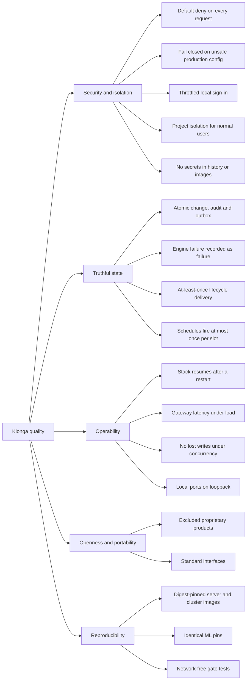

# 10. Quality requirements

This section refines the [quality goals](01-introduction-and-goals.md#quality-goals)
into scenarios. Every scenario names the guarantee the code makes today and the test
or check that would fail if it broke. A scenario without a guard is listed under
[risks](11-risks-and-technical-debt.md) instead.

## Quality tree

## Quality scenarios

### Security and isolation

| ID | Scenario | Expected response | Guarded by |
| --- | --- | --- | --- |
| S1 | A request without credentials reaches `/api/v1/...` | `401`; a page request redirects to sign-in | `TestLocalConsoleRequiresLogin`, `TestLocalAPIRequiresSessionAndLogoutRevokesIt` in `platform/go/internal/auth/local_session_test.go` |
| S2 | A viewer or engineer tries a write outside its role | `403`, and `/api/v1/me` reports the same permissions the API enforces | `TestMeAndEnforcementForViewerRole`, `TestEngineerRoleBoundary` in `platform/go/internal/httpapi/rbac_test.go` |
| S3 | A normal user lists runs in a project they are not assigned to | The runs are not returned | `TestNormalUserCrossProjectIsolation` in `platform/go/internal/httpapi/iam_test.go` |
| S4 | A policy allows an action and another attached policy denies it | Denied; the response names the deciding statement | `TestEvaluateTruthTable`, `TestExplainTraceListsEveryMatchedStatement` in `platform/go/internal/policy/policy_test.go` |
| S5 | The gateway starts with `KIONGA_ENVIRONMENT=production` and a development secret, a non-HTTPS OIDC URL, or a database URL without `sslmode=verify-full` | The process exits with an error naming the setting | `TestProductionFailClosed`, `TestProductionBreakGlassPassword` in `platform/go/internal/runtimeconfig/config_test.go` |
| S6 | Someone guesses a local password repeatedly | After five failures each attempt waits a doubling delay, capped at one minute | `TestLocalLoginThrottlesRepeatedFailuresPerAccount`, `TestLocalLoginDelayIsCapped` |
| S7 | A credential is committed, or a dependency gains a reachable vulnerability | CI fails | `gitleaks`, `govulncheck`, `gosec`, pip-audit and bandit in the shared workflows ([CI gates](../contributing/index.md#ci-gates)) |
| S8 | A vendored browser file changes without its hash | The UI test fails | `platform/tests/ui/vendor-integrity.test.cjs` |
| S9 | The Helm chart renders | Every Deployment is non-root with a read-only root file system and no capabilities, every Service is ClusterIP, no cluster-wide RBAC or Secret is rendered | `test_managed_chart_security_and_availability` in `deploy/tests/test_production_deploy.py` |

### Truthful state

| ID | Scenario | Expected response | Guarded by |
| --- | --- | --- | --- |
| T1 | A resource mutation commits | The resource, its audit event and its outbox rows exist together, or none of them do | `TestPostgresPersistsResourceAuditAndOutboxAtomically` in `platform/go/integration/postgres_integration_test.go` |
| T2 | A lifecycle action is written | It routes to its dedicated command topic | `TestLifecycleActionsRouteToDedicatedTopics` in `platform/go/internal/store/postgres_test.go` |
| T3 | The serving manager rejects a deployment | The model is marked `failed` and the API returns `502` | `TestDeployModelFailsClosedWhenServingRejects` in `platform/go/internal/httpapi/serving_test.go` |
| T4 | An agent runtime is down when someone invokes the agent | `503 agent_not_ready`, nothing forwarded | `TestInvokeAgentGatesUnavailableRuntime`, `TestInvokeAgentRuntimeDown` in `platform/go/internal/httpapi/invoke_test.go` |
| T5 | A record in a lifecycle batch fails to dispatch | No offset is committed for the batch; a commit failure is retried without redispatch and bounded | `TestLifecycleWorkerDoesNotCommitFailedBatch`, `TestLifecycleWorkerRetriesCommitWithoutRedispatch`, `TestLifecycleWorkerBoundsCommitFailure` |
| T6 | Two gateway replicas run the scheduler, or the gateway restarts mid-slot | Only the lease holder fires; a slot never fires twice; after downtime only the latest missed slot runs | `TestOnlyTheLeaseHolderFiresAndSlotsNeverDoubleFire`, `TestCatchUpRunsOnlyTheLatestMissedSlot` in `platform/go/internal/scheduler/scheduler_test.go` |
| T7 | Prefect rejects a submitted flow run | The run is recorded and marked failed with the engine's message, never left queued | `TestSubmitPipelineFailsClosedWhenEngineRejects` in `platform/go/internal/httpapi/pipeline_engine_test.go` |

### Operability

| ID | Scenario | Expected response | Guarded by |
| --- | --- | --- | --- |
| O1 | The Docker host restarts | Every long-running service comes back; one-shot jobs do not rerun | `deploy/tests/test_restart_policy.py` |
| O2 | The gateway serves steady reads, a spike, and transactional writes on a shared CI runner | Fewer than 2% failed requests; reads p95 under 400 ms and p99 under 1 s; writes p95 under 800 ms and p99 under 1.5 s | k6 thresholds in `deploy/tests/load/gateway.js`, run nightly and on `main` by the deploy Pressure workflow |
| O3 | 300 requests arrive with a concurrency of 48 against write and read paths | Zero `5xx`, every write returns `201`, every created resource is persisted | `deploy/scripts/stress-test.sh` in the Pressure workflow |
| O4 | The full stack starts from the component repositories | The end-to-end smoke test passes; skips are reported, not hidden | `deploy/scripts/demo-smoke.sh` (`make -C deploy smoke`) |
| O5 | Someone on the same network scans a developer machine | Local published ports answer only on `127.0.0.1` unless the bind address is widened | `deploy/tests/test_network_exposure.py` |

### Openness and reproducibility

| ID | Scenario | Expected response | Guarded by |
| --- | --- | --- | --- |
| P1 | Code references an excluded proprietary ML operations product | CI fails | The "Enforce architecture exclusions" step in the platform CI and `make -C platform verify` |
| P2 | The bundled object store is changed | Compose still uses pinned RustFS and every S3 client points at `objectstore` | `test_object_store_is_pinned_rustfs_and_every_client_uses_it` in `deploy/tests/test_local_bootstrap.py` |
| R1 | A server or cluster install uses an image tag instead of a digest | The installer or chart refuses it | `test_vm_rejects_unsafe_inputs`, `test_chart_refuses_unpinned_default_images` |
| R2 | A model trained in a notebook or pipeline is served | It loads, because MLflow and scikit-learn match across images | Pins in `pipeline-runner/requirements.txt`, `deploy/mlflow/Dockerfile`, `workspace/jupyter/Dockerfile`; `test_training_images_match_the_server` in `deploy/tests/test_mlflow_server.py` |
| R3 | Gate tests run without network access or API keys | They pass: the mock LLM and hashing embedding function make them deterministic | `sdk-python/tests`, `agent-runtime/tests`; the paid evaluation lane runs only with `MLAIOPS_RUN_EVALS=1` |

## Not yet measured

Throughput and latency of the agent runtime, the trace proxy and model containers have
no thresholds. The Kubernetes pipeline executor, log export and external S3
connections are tested against fakes only. See the
[implementation status](../status/implementation-status.md).
