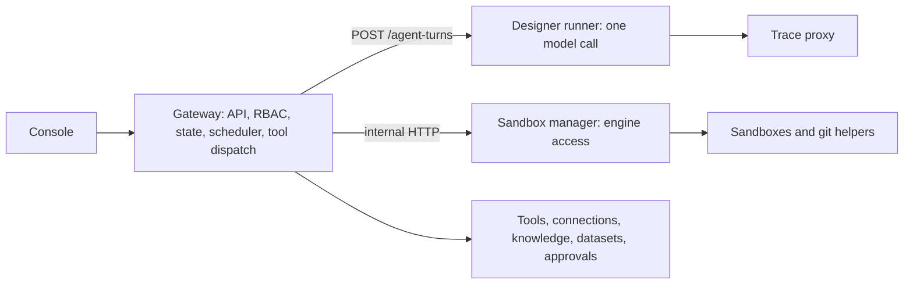

# Agent teams

Agent teams let a coordinator start parallel workers that use tools and code workspaces
in sandboxes. For product behavior, see the
[guide](https://kiongahq.github.io/docs/guides/agent-teams/) and
[reference](https://kiongahq.github.io/docs/reference/agent-teams/).

## Structure

| Part | Where | Responsibility |
| --- | --- | --- |
| State machine | `go/internal/agentteam` in `platform` | Pure transitions with no I/O, so unit tests cover them. |
| Routes and scheduler | `go/internal/httpapi/agent_teams*.go` in `platform` | API, leases, tool dispatch, approvals. |
| Turn endpoint | `agent_runtime/designer.py` in `agent-runtime` | One model call per request. Stores nothing. |
| Sandbox manager | `go/cmd/sandbox-manager`, `go/internal/sandbox` in `platform` | Holds container engine or sandbox namespace access. Stateless: labeled objects are the source of truth. |
| Wiring | `compose.yaml`, `compose.public.yaml`, `helm/kionga` in `deploy` | Networks, tokens, RBAC, NetworkPolicy. |

The loop is deterministic Go in the gateway. LLM egress stays in the runner, through the trace
proxy. No model output runs outside a sandbox.

## Durability

Each worker is its own document, so a transcript write never rewrites the run. A worker runs only
under a lease taken by compare-and-set through `store.UpdateDoc`, for 60 seconds, renewed every 20.
This makes several gateway replicas safe: a dead gateway's worker becomes eligible when its lease
expires. The scheduler scans non-terminal runs on start and every 5 seconds.

The turn loop persists at each step: deliver the inbox, call the runner, persist the assistant
message and tool intents as `pending`, run each tool, persist each result.

**Crash rule.** On resume, a `pending` call with `started_at` set and no result is handled by
effect. A read-only tool runs again. A tool with side effects gets `outcome_unknown` and is never
run again blindly. Where this breaks: an external system that applied the call and lost the
response looks the same as one that never received it, which is why the model and the person have
to check.

## Trust boundaries

- **Authority.** Only a person grants anything. Worker tools come only from the snapshot definition,
  filtered by the starter's access, re-resolved before each turn and each tool call.
- **Provenance.** The gateway wraps inbound content in `kionga-data` with a per-delivery nonce and
  neutralizes the closing tag in the body. This is a mitigation for prompt injection, not a
  guarantee, because the model still reads the content.
- **Runtime.** The manager verifies the runtime at startup and before each create, and fails closed
  with no fallback. An engine's runtime list is not proof, because Podman lists `runsc` when it is
  not installed, so verification uses a probe's kernel report.
- **Engine access.** On Compose, the manager mounts the engine socket, which is root-equivalent on
  the host. It publishes no port, and sits on an internal network shared only with the gateway, behind
  a bearer token. On Kubernetes, its write access stops at the sandbox namespace, and its only cluster
  grant is `get` on the one named RuntimeClass.
- **Git.** The helper never runs git inside a `.git` the agent could have touched, because repository
  config, hooks, `core.sshCommand`, `core.fsmonitor` and filters are code execution paths into the
  credentialed process. Clone happens in an empty directory. Push fresh-clones the remote and fetches
  from a bundle as data, with hooks and system and global config disabled.
- **Unsafe flag.** `KIONGA_SANDBOX_ALLOW_UNSAFE_RUNTIME` is a local development opt-in. The manager
  refuses it in production, `compose.public.yaml` pins it empty, `public-preflight.sh` rejects it, and
  the chart has no value for it.

## Kubernetes network rules

The chart ships `<prefix>default-deny` with an empty pod selector, and the manager holds only `get` on
NetworkPolicy, so it fails closed if the policy is missing and cannot change it. Sandbox pods match no
allow rule, so the API server, cluster services and metadata are unreachable from them.

Only pods labeled `kionga.dev/sandbox-role=git-helper` get egress: DNS and TCP 443 to public addresses,
excluding private ranges, `169.254.0.0/16` and `sandbox.kubernetesApiCidrs`. Sandbox code cannot gain that
label. Only the manager's Role can create pods, it has no `update` or `patch`, and sandbox pods have no
service account token and no route to the API server.

## Known limits

- No egress allowlists for sandboxes, nested teams, teams as a canvas node, operator deployment of a team
  as a long-lived service, or per-tenant sandbox node pools.
- All tenants' sandboxes share a namespace and its nodes, so isolation between them relies on gVisor.
- Git helper egress is by IP range, not host. The host allowlist is enforced by the manager, so a compromised
  helper could reach any public HTTPS address during its short life, holding one operation's credential.
- A public API server address outside `sandbox.kubernetesApiCidrs` stays reachable from git helpers, which
  hold no service account token.
- NetworkPolicy rules depend on a network plugin that enforces them.

## Measuring it

`team_run.*` audit events, per-run usage, resume count and the team evaluation score show whether teams work.
