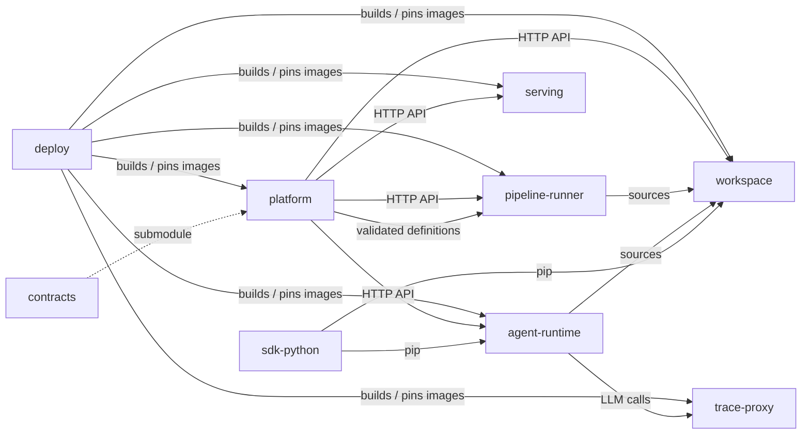

# Repositories

Kionga is developed as a set of repositories in the
[kiongahq](https://github.com/kiongahq) GitHub organization. Each one builds, tests and
releases on its own; they meet at versioned contracts, HTTP APIs and container
images, and [deploy](https://github.com/kiongahq/deploy) runs them together.

| Repository | What it holds | Ships as |
| --- | --- | --- |
| [platform](https://github.com/kiongahq/platform) | Control plane: gateway API, console, auth and IAM policies, PostgreSQL store, scheduler, pipeline validation and execution, logs, editorial, operator, feature gateway, storage proxy, integration worker, log exporter, CLI | `ghcr.io/kiongahq/{gateway,operator,feature-gateway,storage-proxy,integration-worker,metrics-collector,log-exporter,cli}` |
| [contracts](https://github.com/kiongahq/contracts) | Versioned schemas shared across components (`kionga.dev/v1 Pipeline`) | Git tags; a submodule of `platform` |
| [`sdk-python`](https://github.com/kiongahq/sdk-python) | Python SDK: client, models, pipelines, agents, LLM factory, tools, tracing | Wheel and `sdist` on GitHub releases |
| [agent-runtime](https://github.com/kiongahq/agent-runtime) | Agent serving runtime, example agents, feature materializer, real-time processor | `ghcr.io/kiongahq/agent-runtime` |
| [pipeline-runner](https://github.com/kiongahq/pipeline-runner) | Prefect runner that executes pipeline DAGs as containers | `ghcr.io/kiongahq/pipeline-runner` |
| [serving](https://github.com/kiongahq/serving) | Model serving manager | `ghcr.io/kiongahq/serving-manager` |
| [trace-proxy](https://github.com/kiongahq/trace-proxy) | OpenAI-compatible LLM egress with tracing | `ghcr.io/kiongahq/trace-proxy` |
| [workspace](https://github.com/kiongahq/workspace) | Jupyter workbench, browser IDE, `kionga` workspace CLI and sidecar | `ghcr.io/kiongahq/{jupyter,ide}` |
| [deploy](https://github.com/kiongahq/deploy) | Compose stack, single-VM install, Helm chart, kind, cluster config | The running system |
| [docs](https://github.com/kiongahq/docs) | Product documentation and this handbook | <https://kiongahq.github.io/docs/> |
| [.github](https://github.com/kiongahq/.github) | Organization profile, shared CI workflows, repository list | Reusable workflows |

## How the pieces connect



- **Contracts** are the only shared source. The platform pins them as a Git
  submodule at `platform/contracts`; a change is a new tag that consumers adopt.
- **Python packages** flow one way: `sdk-python` is installed by `agent-runtime` and
  the Jupyter workbench, pinned to a release tag (`SDK_VERSION`).
- **Runtime calls** go through the platform gateway's HTTP API with a service token;
  components never import each other's code.
- **Images** are published per repository (`latest`, `sha-<short>`, and semantic version on
  `v*` tags). `deploy/vm/compose.yaml` and the Helm chart run them pinned by digest.

## Working across repositories

Clone everything into one folder with `make -C deploy workspace`:

```text
kionga/
  deploy/  platform/  contracts/  sdk-python/  agent-runtime/
  pipeline-runner/  serving/  trace-proxy/  workspace/  docs/
```

Paths in these docs are relative to that folder. `make -C deploy local-up` builds
every image from these checkouts and rebuilds only what changed, including a change
in a repository another image depends on (the SDK, for example). To build the Python
images against released dependencies instead, set `KIONGA_SDK_SOURCE=release`.

A change that spans repositories (say a new gateway endpoint the SDK calls):

1. land the provider side first (`platform`), keeping the old behaviour working;
2. release it, then update and release the consumer (`sdk-python`);
3. bump the pins that reference it (`SDK_VERSION` in `agent-runtime` and
   `workspace`, image digests in `deploy`).

`deploy`'s CI clones every component's `main` branch and runs the cross-repository
checks, so a change that breaks how the pieces fit together fails there.

## Shared CI

Each repository's workflow calls the reusable workflows in
[kiongahq/.github](https://github.com/kiongahq/.github):

| Workflow | Does |
| --- | --- |
| `go.yml` | gofmt, `go vet`, `go test -race`, build, then `govulncheck`, `gosec` and `gitleaks` |
| `python.yml` | install, `ruff check`, `pytest`, then `pip-audit`, `bandit` and `gitleaks` |
| `image.yml` | build, then publish to `ghcr.io/kiongahq/<image>` from `main` and `v*` tags |

## Component pages

| Page | Services |
| --- | --- |
| [Gateway and control plane](gateway.md) | gateway, `dex`, operator, integration-worker, metrics-collector, log-exporter, `cli` |
| [Data and messaging](data-plane.md) | `postgres`, `redis`, `kafka`, `kafka-rest`, `objectstore`, `mlflow`, feature-gateway, storage-proxy, feature-materializer |
| [Execution and serving](execution.md) | `prefect-server`, pipeline-runner, serving-manager, OpenFaaS |
| [AI and observability](ai-observability.md) | agent-runtime, trace-proxy, `langfuse`, `realtime-processor`, `jupyter` |
| [Workspace](workspace.md) | Jupyter and IDE images, the `kionga` CLI, the scaffold sidecar |
| [Contracts repository](contracts.md) | The `kionga.dev/v1 Pipeline` schema |
| [Go packages](go-packages.md) | Every package of the platform Go module |
| [Python modules](python-modules.md) | The SDK and the workload modules |

The contribution workflow is in [contributing](../contributing/index.md).
